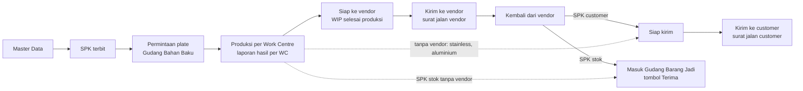

# Framework alur sistem: dari Master Data sampai kirim atau masuk gudang

Satu halaman untuk menjawab "sistem ini mulai dari mana dan mengalir ke mana", supaya pengembangan tidak melebar. Pelengkap [[PETA_MODUL]] (peta per modul) dan [[CARA_KERJA_RUTE_PRODUKSI]] (rute per item). Disusun dari kode dan catatan yang ada; bagian bertanda **perlu keputusan** belum disepakati pemilik.

## 1. Alur utama

## 2. Tahap, layar, dan data

| # | Tahap | Layar | Data utama | Aturan penjaga | Status kode |
|---|---|---|---|---|---|
| 0 | Master Data | Master Data | customer, vendor, supplier, armada, Work Centre, mesin, rute produksi, aturan proses, bahan baku, Opsi SPK | nama Work Centre harus sama dengan langkah rute; master yang dipakai tidak bisa dihapus permanen | ada |
| 1 | SPK | SPK Berjalan (Daftar SPK) | `spk` (item, dari stok, jenis customer atau stok) | Draft belum menghitung apa pun; Terbit mengunci nomor dan snapshot rute per item | ada |
| 2 | Permintaan bahan baku | Gudang Bahan Baku (kebutuhan plat, Serah terima plate, PR) | kebutuhan plat turunan dari SPK Terbit (berat estimasi dikurangi dari stok), `mutasi` PK, `pr` | kekurangan menjadi PR; plate harus diserahkan sebelum produksi (peringatan di SPK dan antrian) | ada |
| 3 | Produksi per Work Centre | Produksi Hari Ini, Papan, Jadwal | `produksi_log` per item per Work Centre (hasil, reject, mulai, selesai) | urutan langkah dijaga; jumlah tidak melebihi yang lolos langkah sebelumnya; kejadian tidak diubah, hanya dibatalkan | ada |
| 4 | Laporan produksi per Work Centre | Dashboard Produksi atau Kinerja & Analisa, Laporan Produksi | turunan dari `produksi_log` | hanya membaca | ada, **bentuk tampilan perlu keputusan** |
| 5 | Siap ke vendor | SPK (posisi), Kirim ke Vendor | turunan: hasil langkah internal terakhir dikurangi yang sudah dikirim | hanya bila rute punya langkah vendor (finishing ELG, HDG, PDC dari judul section) | posisi ada; **antrian Siap dikirim ke vendor belum dibangun (F-11)** |
| 6 | Kirim ke vendor | Kirim ke Vendor, Bongkar Muat (loading) | `vendor` (surat jalan vendor), `marmada` | beberapa SPK dalam satu armada didukung; batal SJ dijaga | ada |
| 7 | Kembali dari vendor | Kirim ke Vendor (Terima), Bongkar Muat (unloading) | `vendor.kembali` | jumlah kembali tidak melebihi yang dikirim | ada |
| 8a | Siap kirim customer | Gudang Barang Jadi, tab Siap kirim customer | turunan: hasil siap dikurangi yang sudah dikirim | SPK stok tidak muncul | ada (lokal) |
| 8b | Kirim ke customer | Kirim ke Customer (surat jalan, banyak SPK satu armada) | `kirim`, `mutasi` BJ-K bila dari stok | hanya sebesar hasil siap; override bertanda keterangan | ada |
| 9 | SPK stok masuk gudang | Gudang Barang Jadi, tab Siap masuk stok | `mutasi` BJ-M, `fg` | hanya sebesar hasil selesai (dan kembali dari vendor bila ada) | ada (lokal) |

Pengikat lintas tahap: nomor SPK, `item_idx` (urutan item), nomor dokumen, dan tanda `stokReq`. Stok selalu turunan dari `mutasi`, tidak disimpan sebagai angka.

## 3. Dua jalur SPK

- **SPK customer:** SPK, Permintaan plate, Produksi, Siap ke vendor, Kirim ke vendor, Kembali, Siap kirim, Kirim ke customer. Bila ada **Dari stok**, bagian itu langsung keluar dari Gudang Barang Jadi dan kebutuhan plat berkurang.
- **SPK stok:** sama sampai Kembali dari vendor, lalu masuk Gudang Barang Jadi lewat Terima. Tidak pernah ke customer.

## 4. Batas supaya tidak melebar

Inti yang dijaga sekarang: **Master Data, SPK, Gudang Bahan Baku, Produksi per Work Centre, Vendor, Gudang Barang Jadi, Kirim ke Customer, Bongkar Muat, Cek Data, Pengguna & Akses.**

Di luar inti (jangan dikembangkan dulu, tidak mengganggu alur):

| Bagian | Sikap |
|---|---|
| Penawaran dan Sales Order | disembunyikan; tidak ikut akses dan peran sampai diminta |
| Gudang Sparepart | berdiri sendiri; tidak masuk alur SPK |
| Jadwal (Gantt), KPI & Analisa, Kinerja Tim | pelengkap membaca data; tidak boleh mengubah data alur |
| Layout input SPK per dimensi (Kg estimasi dan real) | fitur pengembangan di balik pengaturan, belum menjadi bawaan |

Aturan perubahan: perubahan di satu tahap tidak boleh menulis ke tahap lain kecuali lewat penghubung di bagian 2 (nomor SPK, `item_idx`, `mutasi`, dokumen).

## 5. Celah yang perlu diputuskan (urut prioritas)

1. **F-11:** antrian "Siap dikirim ke vendor" dan serah terima WIP (tahap 5) belum ada sebagai layar sendiri.
2. **F-12:** kapan SPK dianggap **Terkirim** (semua item sampai customer, atau masuk gudang untuk SPK stok).
3. **Laporan produksi:** tampilan mana yang dipakai (Dashboard Produksi lama atau Kinerja & Analisa baru); data sumbernya sama.
4. **Input SPK:** bawaan teks Description atau per dimensi; dengan katalog berat terpasang jalur lama masih menampilkan bentuk dan ukuran.
5. **F-13, F-14:** duplikasi tab Item di SPK, dan aturan Cek Data untuk plate, rute, dan WIP.
6. **Work Centre production** perlu dicocokkan dengan nama langkah rute sebelum dipakai operator.
